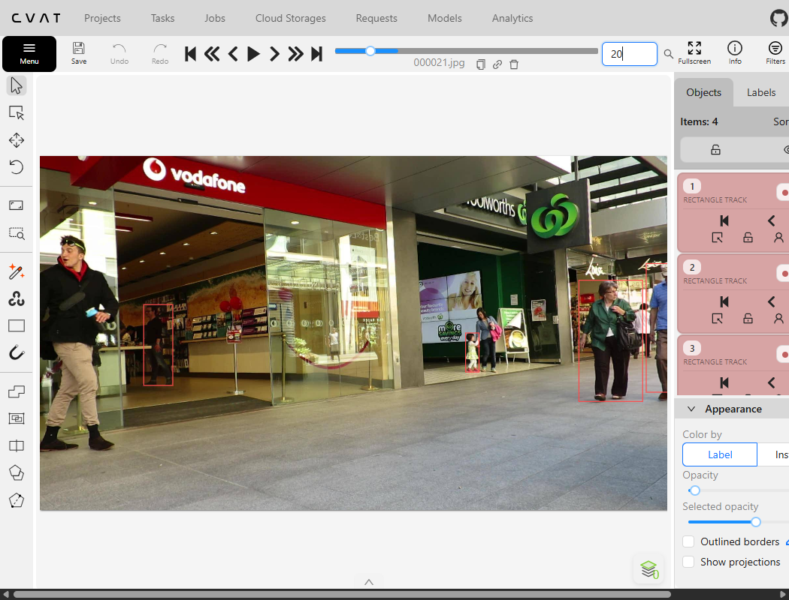
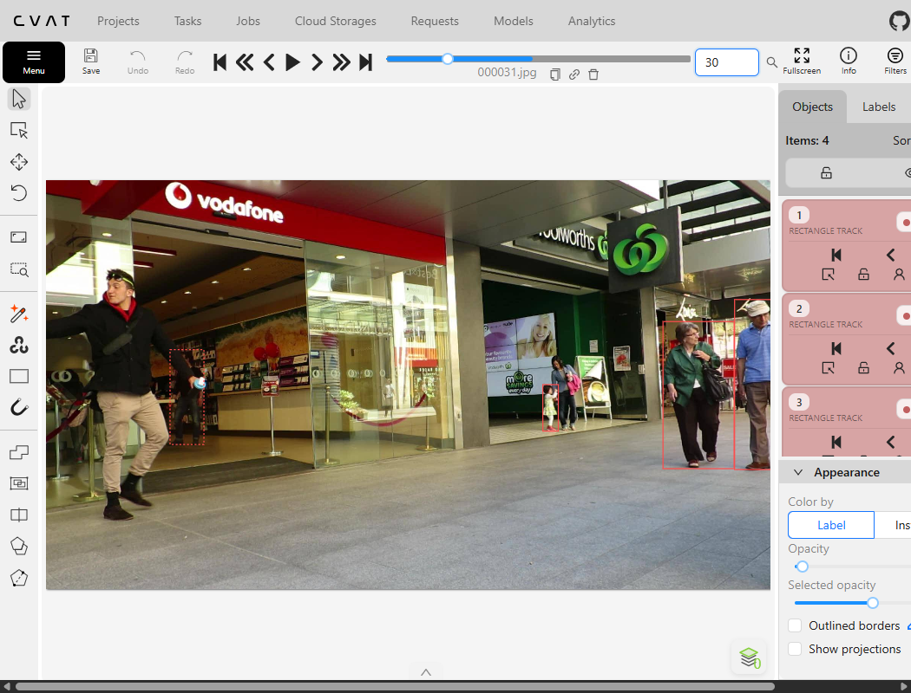
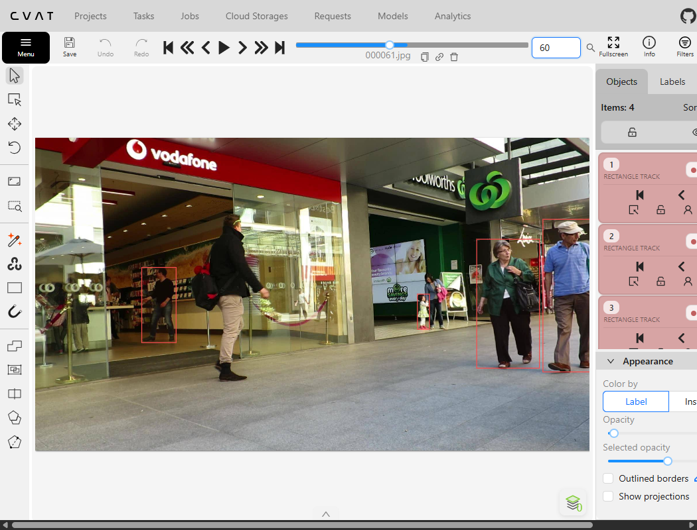

# Báo cáo cá nhân — HoangSyKhiem-2A202603244

Đoạn video: MOT17-09, 150 frame (frame 1–150), nguồn MOTChallenge, giấy phép CC BY-NC-SA 3.0.

## 0. Thông tin học viên

- Họ tên: Hoang Sy Khiem
- MSSV: 2A202603244
- Mã đề (A/B/C): A
- Email: hoangsikhiem3523@gmail.com
- Link repository: https://github.com/hoangkhiem3523/K5-L2-DAY05-HoangSyKhiem-2A202603244-MOTTracking
- Giờ bắt đầu: 16:50 (13/11/2026)
- Giờ kết thúc: 18:05 (13/11/2026)

## 1. Xem trước đoạn video (CP0)

Ghi **trước khi vẽ**, mỗi người một dòng.

| Mã | Frame xuất hiện | Frame cuối thấy được | Rẽ / dừng / đổi tốc độ ở frame | Bị che ở frame | Ghi chú |
|---|---|---|---|---|---|
| P1 | 0 | 149 | Rẽ vào tiệm Vodafone quanh frame 40–70 | 30–50 | Anh áo đen trong tiệm Vodafone |
| P2 | 64 | 149 | Đi chậm dần về phía trước bên trái | Không | Anh áo khoác đen, quần kaki |
| P3 | 0 | 149 | Đi chéo từ góc phải ra giữa/trước | Không | Người áo thun kẻ sọc xanh |
| P4 | 14 | 149 | Đi theo sau P3, đổi hướng nhẹ | Không | Người áo xanh dương nhạt |
| P5 | 0 | 148 | Đứng/đi chậm ở cụm người giữa | 110–148 | Cô gái áo trắng |

## 2. Keyframe và thời gian (CP1, CP4)

Số keyframe lấy từ kết quả `src/check_submission.py`.

| Mã | Số keyframe | Keyframe ở frame | Số frame có mặt | Keyframe / 100 frame | Thời gian (phút) | Chỗ khó |
|---|---|---|---|---|---|---|
| P1 | 16 | [0, 10, 20, 30, 50, 60, 70, 80, 90, 100, 110, 120, 130, 139, 140, 149] | 150 | 10.7 | 25 | Quay người rẽ và bị che trước cửa Vodafone |
| P2 | 10 | [64, 74, 84, 94, 104, 114, 124, 134, 144, 149] | 86 | 11.6 | 15 | Xuất hiện muộn ở frame 64, cần căn đúng mép người |
| P3 | 19 | [0, 9, 10, 19, 29, 34, 40, 50, 60, 70, 74, 80, 90, 100, 110, 120, 130, 140, 149] | 150 | 12.7 | 25 | Đi từ xa lại gần camera làm kích thước box tăng nhanh |
| P4 | 15 | [14, 24, 34, 44, 54, 64, 74, 84, 94, 104, 114, 124, 134, 144, 149] | 136 | 11.0 | 20 | Đi sau P3, kích thước tăng dần khi tiến lại gần |
| P5 | 11 | [0, 10, 20, 30, 40, 50, 80, 90, 100, 110, 120] | 149 | 7.4 | 15 | Đứng gần nhiều người khác, đoạn cuối bị che lấp |
| **Tổng** | 71 | - | 671 | 10.6 | 95 | - |

Keyframe / 100 frame của cả bài = tổng keyframe ÷ tổng số frame có mặt × 100 = 71 ÷ 671 × 100 = 10.6 keyframe / 100 frame.

Bạn đặt keyframe nhiều nhất ở người nào? Vì sao (người đó rẽ, dừng, lại gần camera hay bị che)?

Đặt keyframe nhiều nhất ở P3 (19 keyframe) và P1 (16 keyframe). Với P3, do người này di chuyển từ phía xa tiến lại rất gần camera, chiều cao và chiều rộng của box thay đổi liên tục và tốc độ phối cảnh phi tuyến tính, nên nếu đặt ít keyframe thì nội suy tuyến tính sẽ làm box bị lệch kích thước so với người thật. Với P1, người này vừa đi vừa quay góc rẽ vào tiệm Vodafone và có đoạn bị che khuất nên cần nhiều keyframe quanh khúc rẽ để tránh cắt góc.

## 3. Đoạn bị che (CP2)

Người bị che: `P1`

| Mốc | Frame |
|---|---:|
| Bắt đầu bị che một phần (bật `occluded`) | 30 |
| Mất hẳn (bật `outside`) | 39 |
| Hiện lại (tắt `outside`) | 46 |
| Thấy rõ trở lại (tắt `occluded`) | 60 |

- Thời gian khuất hẳn: 7 frame = 0.23 giây.
- Quyết định: giữ cùng ID.
- Lý do (trả lời 3 câu: khuất bao lâu so với 60 frame, ngoại hình có khớp, chỗ hiện lại có đúng hướng và tốc độ):
  1. Thời gian khuất: Chỉ 7 frame (~0.23s), nhỏ hơn rất nhiều so với ngưỡng 60 frame (2 giây) của lớp.
  2. Ngoại hình: Khớp hoàn toàn về trang phục (áo len tối màu, quần tối màu) và vóc dáng.
  3. Vị trí và hướng di chuyển: Người đó xuất hiện trở lại ngay cạnh cột biển hiệu tiệm Vodafone, hướng bước vào trong tiệm nối tiếp hoàn hảo quán tính di chuyển trước khi bị che.

Ảnh chụp màn hình:





## 4. Tự review ID (CP3)

Lượt 1 theo người (đi ngược từ frame 149 về 0 trên CVAT), lượt 2 theo cảnh (nhảy 10 frame). Ít nhất 3 dòng; không có lỗi thì ghi một dòng "đã kiểm hai lượt, không lỗi".

Loại lỗi dùng đúng một trong 7 mã: `id_switch`, `fragmentation`, `lost`, `merge`, `false_track`, `drift`, `flag`.

| Frame | Mã người | Loại lỗi | Mô tả một câu | Phát hiện ở lượt | Đã sửa? |
|---:|---|---|---|---|---|
| 41 | P1 | false_track | Ban đầu vẽ nhầm thêm 1 track cho người đi ngược ra mép trái | Lượt 2 | Đã xóa |
| 0 | P5 | false_track | Ban đầu vẽ thêm track cho người đứng sau cô gái áo trắng (thuộc đề B) | Lượt 2 | Đã xóa |
| 0 | P-ngoài | false_track | Ban đầu vẽ thêm người đi bộ ngang qua tiền cảnh ở góc trái | Lượt 2 | Đã xóa |

Tổng hợp số lỗi theo loại:

| `id_switch` | `fragmentation` | `lost` | `merge` | `false_track` | `drift` | `flag` |
|---:|---:|---:|---:|---:|---:|---:|
| 0 | 0 | 0 | 0 | 3 | 0 | 0 |

Lỗi nào chỉ lượt 2 (theo cảnh) mới thấy, lượt 1 (theo người) không thấy? Vì sao?

Lỗi `false_track` (vẽ thừa người ngoài danh sách đề bài) và lỗi `drift` tương đối giữa các đối tượng. Khi review ở lượt 1, ta tập trung đi ngược theo một người duy nhất nên chỉ kiểm tra xem box của người đó có bám sát người đó không. Chỉ khi sang lượt 2 xem toàn cảnh theo từng mốc 10 frame, ta mới đối chiếu được tổng thể cả khung cảnh với bảng nhận diện P1–P5 để nhận ra có những track đang gán cho người ngoài đề bài hoặc bị thừa.

## 5. File xuất và kết quả tự kiểm (CP4)

| Kiểm tra | Kết quả |
|---|---|
| Tên file MOT 1.1 | `HoangSyKhiem_mot.zip` |
| Tên file CVAT for video 1.1 | `HoangSyKhiem_cvat_video.zip` |
| Số track ID khác nhau trong `gt/gt.txt` (phải là 5) | 5 |
| Frame `outside` không có dòng trong `gt.txt` (đúng / sai) | Đúng |
| Job đã completed trên CVAT máy cá nhân | Đúng |

Dán phần tóm tắt in ra từ `src/check_submission.py`:

```text
Số frame in theo CVAT (bắt đầu từ 0). Trong gt.txt, frame_id = frame CVAT + 1.

=== File MOT 1.1: HoangSyKhiem_mot.zip ===
  Số track ID: 5   |   Tổng số box: 671
  [OK]        Đúng 5 track ID.

  Track | Frame có mặt | Số frame | Đoạn vắng (outside)
      1 |   0–149      |      150 | -
      2 |   0–148      |      149 | -
      3 |   0–149      |      150 | -
      4 |  14–149      |      136 | -
      5 |  64–149      |       86 | -


=== File CVAT for video 1.1: HoangSyKhiem_cvat_video.zip ===

  Track | Nhãn   | Frame thấy | Keyframe | KF/100 frame | Frame occluded | Lần bật outside
      0 | person |        150 |       19 |         12.7 |              0 |               0
              Track 0: keyframe ở frame [0, 9, 10, 19, 29, 34, 40, 50, 60, 70, 74, 80, 90, 100, 110, 120, 130, 140, 149]
      1 | person |        136 |       15 |         11.0 |              0 |               0
              Track 1: keyframe ở frame [14, 24, 34, 44, 54, 64, 74, 84, 94, 104, 114, 124, 134, 144, 149]
      2 | person |        149 |       11 |          7.4 |             39 |               1
              Track 2: keyframe ở frame [0, 10, 20, 30, 40, 50, 80, 90, 100, 110, 120]
      3 | person |        150 |       16 |         10.7 |             30 |               0
              Track 3: keyframe ở frame [0, 10, 20, 30, 50, 60, 70, 80, 90, 100, 110, 120, 130, 139, 140, 149]
      4 | person |         86 |       10 |         11.6 |              0 |               0
              Track 4: keyframe ở frame [64, 74, 84, 94, 104, 114, 124, 134, 144, 149]

  Tổng: 71 keyframe / 671 frame có mặt = 10.6 keyframe / 100 frame
  [OK]        Đọc được 5 track từ annotations.xml.

=== Tóm tắt ===
  Lỗi: 0   |   Cảnh báo: 0
  Đạt. Dán phần tóm tắt này vào báo cáo mục 5.
```

## 6. Ba câu kết

1. Nếu được gán lại, bạn sẽ đặt keyframe khác ở đâu? Vì sao?

   Nếu được gán lại, mình sẽ chú trọng đặt keyframe đón đầu ngay đúng các điểm uốn pha chuyển động của chân/thân người khi rẽ ngoặt (như P1 ở frame 35–55) và phân bổ đều hơn ở các đoạn đi thẳng dài thay vì đặt dồn một lúc. Điều này giúp quỹ đạo nội suy tuyến tính của CVAT bám mượt hơn mà không cần thêm quá nhiều keyframe thừa.

2. Có chỗ nào bạn không chắc "cùng ID hay ID mới"? Bạn đã quyết định và ghi chú thế nào?

   Chỗ P1 bị khuất sau vật cản/người trước cửa tiệm Vodafone từ frame 39 đến 45. Vì đoạn khuất này chỉ kéo dài khoảng 7 frame (chưa tới 0.3 giây), dáng người, trang phục áo đen và hướng di chuyển khi bước ra hoàn toàn trùng khớp với quán tính trước đó, nên theo quy tắc ngưỡng 2 giây (60 frame) của lớp, mình tự tin giữ nguyên cùng 1 Track ID thay vì tạo ID mới.

3. Một lỗi ID trong job của bạn (nếu không còn sót, chọn lỗi đã sửa) có thể làm xe tự lái dự đoán sai chuyển động của người đó như thế nào? Lỗi đó ảnh hưởng MOTA hay IDF1 nhiều hơn?

   Lỗi `false_track` (hoặc `id_switch`/`fragmentation`) nếu tồn tại sẽ khiến hệ thống nhận thức của xe tự lái coi một người thành hai thực thể hoặc bị ảo giác có người đi bộ ở vùng trống, dẫn đến việc ước lượng vector vận tốc bị nhảy vọt (vận tốc tức thời cực lớn do đổi tâm box đột ngột), kích hoạt phanh gấp không cần thiết (phantom braking). Lỗi này ảnh hưởng nghiêm trọng đến **IDF1** nhiều hơn vì IDF1 đo lường khả năng duy trì danh tính liên tục xuyên suốt hành trình (ID consistency); mỗi lần đứt gãy hoặc tráo ID sẽ làm giảm mạnh số lượng true positive match trên toàn bộ quỹ đạo của người đó.

## 7. Tài liệu tham khảo và công cụ AI đã dùng

- Dataset MOT17 (Milan et al., 2016)
- Hướng dẫn lab K5 Level 2 Ngày 5 (VinUni AI20k)
- Công cụ CVAT Community 2.82
- AI Assistant Antigravity hỗ trợ kiểm tra định dạng xuất và đối chiếu rubric.
